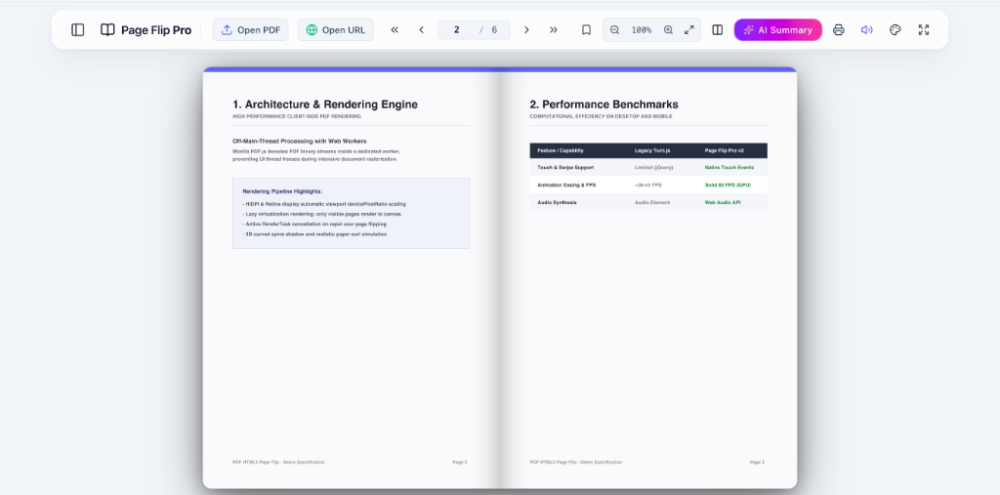

# PDF HTML5 Page Flip Pro (`pdf-html5-page-flip`)

[](LICENSE)
[](https://www.typescriptlang.org/)
[](https://vitejs.dev/)
[](https://react.dev/)
[](https://tailwindcss.com/)
[](https://flipbook.apps.gracer.ai)

<p align="center">
  <a href="https://flipbook.apps.gracer.ai" target="_blank" rel="noopener noreferrer">
    
  </a>
</p>

A modern, high-performance, client-side 3D Web Application and React Component that converts standard PDF files into realistic, hardware-accelerated HTML5 flipbooks with physics-based page turning, memory virtualization, full-text search, customizable branding, and on-demand AI document summarization.

Live Production Website: [https://flipbook.apps.gracer.ai](https://flipbook.apps.gracer.ai) (or [https://pdf-flip.apps.gracer.ai](https://pdf-flip.apps.gracer.ai))

---

## Key Highlights and Architecture

* Immersive Reading Theater Mode: Enlarges the flipbook out from the container to span the entire screen with a high-end frosted glass backdrop (`backdrop-blur-3xl`) and ambient aura illumination.
* Multi-Model AI Document Intelligence: On-demand executive summaries with live provider switching between Google Gemini 2.5 Flash, OpenAI GPT-4o, or 100% private offline browser-native extractive NLP.
* 100% Client-Side Privacy: All parsing and rendering execute directly in the browser runtime using PDF.js and Web Workers. Confidential documents never leave the client device.
* 60 FPS GPU Paper Peel Simulation: GPU cubic-bezier physics, realistic curvature, dynamic book spine shadow depth, and natural paper friction audio.
* Complete Keyboard Navigation: Full hotkey matrix for distraction-free reading (`Arrows`, `Space`, `PageUp/Down`, `Home/End`, `F`, `I`, `ESC`, `+`, `-`, `0`, `M`, `S`).
* Synthesized Paper Audio: Dynamically generates organic paper friction sounds on-the-fly via the Web Audio API without external audio files or network overhead.
* HiDPI and Retina Sharpness: Canvases scale dynamically based on `window.devicePixelRatio` for crisp text and illustrations across all zoom levels.
* Full-Text Search & Native Outline: Scans and indexes document text with context snippets and extracts native PDF bookmarks for hierarchical Table of Contents navigation.
* Drop-in Component: Available as both a type-safe React component (`<PdfFlipbook />`) and a zero-dependency Web Component (`<pdf-flipbook>`).

---

## Quick Start (React Component)

### 1. Installation

Configure your project `.npmrc` to route the `@iamapinan` scope to GitHub Packages:

```shell
@iamapinan:registry=https://npm.pkg.github.com
```

Install the package:

```bash
npm install pdf-html5-page-flip
```

### 2. Basic Usage

```tsx
import React from 'react';
import { PdfFlipbook } from 'pdf-html5-page-flip/react';
import 'pdf-html5-page-flip/style.css';

export default function DocumentViewer() {
  return (
    <div style={{ width: '100vw', height: '100vh' }}>
      <PdfFlipbook
        src="/assets/sample.pdf"
        theme="dark"
        mode="auto"
        accentColor="#6366f1"
        showLogo={true}
        onPageChange={(page, total) => console.log(`Active: ${page}/${total}`)}
      />
    </div>
  );
}
```

---

## Props API Reference (`<PdfFlipbook />`)

| Prop | Type | Default | Description |
|---|---|---|---|
| `src` | `string \| File \| ArrayBuffer` | Required | PDF source URL string, File object, or raw ArrayBuffer |
| `theme` | `'dark' \| 'light' \| 'wood'` | `'dark'` | Overall reading background theme |
| `mode` | `'auto' \| 'single' \| 'double'` | `'auto'` | Page presentation mode (auto-detects viewport width) |
| `accentColor` | `string` | `'#6366f1'` | Accent color used for highlights, icons, and buttons |
| `showLogo` | `boolean` | `true` | Show or hide brand logo and title in the top toolbar |
| `showToolbar` | `boolean` | `true` | Show top glassmorphism toolbar |
| `showSidebar` | `boolean` | `true` | Show collapsible left sidebar drawer |
| `showNavigation` | `boolean` | `true` | Show page turn buttons and direct page jump input |
| `showSearch` | `boolean` | `true` | Enable full-text keyword search tab |
| `showOutline` | `boolean` | `true` | Enable document Table of Contents (TOC) tab |
| `showBookmarks` | `boolean` | `true` | Enable page bookmarking and saved marks tab |
| `showThumbnails` | `boolean` | `true` | Enable visual page thumbnails grid tab |
| `showAiSummary` | `boolean` | `true` | Enable AI assistant modal and summarizer |
| `showZoom` | `boolean` | `true` | Enable zoom in, zoom out, and fit controls |
| `showPrint` | `boolean` | `true` | Enable single-page image export and print |
| `showSound` | `boolean` | `true` | Enable synthesized paper friction audio |
| `immersive` | `boolean` | `false` | Enable immersive reading mode (expands full screen with blurred glass backdrop) |
| `onImmersiveChange` | `(isImmersive: boolean) => void` | `undefined` | Callback fired when immersive mode toggles |
| `showFullscreen`| `boolean` | `true` | Enable fullscreen / immersive mode toggle button |
| `showThemeToggle`| `boolean`| `true` | Enable theme cycler in toolbar |
| `showViewToggle` | `boolean` | `true` | Enable single/double page switcher button |
| `showFileUpload` | `boolean` | `true` | Enable local PDF picker button |
| `showUrlInput` | `boolean` | `true` | Enable remote URL input modal button |
| `flippingTime` | `number` | `800` | Duration of flip animation in milliseconds |
| `onPageChange` | `(page, total) => void` | `undefined` | Callback fired when current page changes |
| `onDocumentLoad`| `(pdfDoc) => void` | `undefined` | Callback fired when PDFDocumentProxy is resolved |
| `onFileSelect` | `(file: File) => void` | `undefined` | Callback fired when a local file is opened inside viewer |

---

---

## Immersive Reading Mode

Immersive Mode enlarges the flipbook out of the standard page frame into a distraction-free, full-screen reading theater:

* Frosted Glass Backdrop: Utilizes real-time hardware-accelerated CSS `backdrop-filter: blur(32px)` with subtle ambient aura lighting.
* Automatic Viewport Adaptation: Dynamically re-measures available screen width and height to render the largest possible dual-page or single-page spread.
* Keyboard-First Interaction: Toggle instantly using `F` or `I`, and exit seamlessly using `ESC`.
* Programmatic Control: Pass the `immersive={true}` prop or dispatch `window.dispatchEvent(new CustomEvent('flipbook:toggle-immersive'))`.

---

## AI Document Intelligence and Model Configuration

PDF HTML5 Page Flip Pro features an integrated, multi-provider AI document synthesis engine:

### Supported AI Providers

1. Offline Extractive NLP (Default):
   * 100% Free and Private: Runs entirely inside the client sandbox using TF-IDF sentence scoring.
   * Zero Setup: No API keys or network connection required.
2. Google Gemini API:
   * Models: `gemini-2.5-flash` (recommended for speed and intelligence), `gemini-2.0-flash`, `gemini-1.5-pro`.
   * Setup: Get a free API key at [Google AI Studio](https://aistudio.google.com/app/apikey).
3. OpenAI ChatGPT:
   * Models: `gpt-4o-mini` (cost-efficient) and `gpt-4o` (high intelligence).
   * Setup: Obtain an API key from the [OpenAI Platform](https://platform.openai.com/api-keys).

### Programmatic Configuration

Configure credentials programmatically in your application before rendering the component:

```typescript
// Pre-configure Google Gemini 2.5 Flash
localStorage.setItem('flipbook_ai_provider', 'gemini');
localStorage.setItem('flipbook_ai_gemini_model', 'gemini-2.5-flash');
localStorage.setItem('flipbook_ai_gemini_key', process.env.NEXT_PUBLIC_GEMINI_API_KEY || '');

// Or pre-configure OpenAI GPT-4o-mini
localStorage.setItem('flipbook_ai_provider', 'openai');
localStorage.setItem('flipbook_ai_openai_model', 'gpt-4o-mini');
localStorage.setItem('flipbook_ai_openai_key', process.env.NEXT_PUBLIC_OPENAI_API_KEY || '');
```

### Direct Client Privacy Protocol

All generative synthesis requests execute directly from the client browser via encrypted HTTPS to Google AI or OpenAI endpoints. Confidential document data is never sent to intermediate proxies or third-party tracking services.

---

## Complete Keyboard Shortcuts Reference

| Key | Action |
|---|---|
| `Arrow Right` / `Page Down` / `Space` | Turn to next page |
| `Arrow Left` / `Page Up` | Turn to previous page |
| `Home` | Jump to first page (Cover) |
| `End` | Jump to last page (Back Cover) |
| `F` / `I` | Toggle Immersive Theater Mode |
| `Escape` | Exit Immersive Mode / Close active modals |
| `+` / `=` | Zoom in (up to 200%) |
| `-` / `_` | Zoom out (down to 60%) |
| `0` | Reset zoom to 100% |
| `M` | Toggle paper friction audio mute |
| `S` | Toggle left navigation sidebar (TOC / Thumbs) |
| `Touch Swipe` | Natural 3D paper peel physics |

## Web Component Usage (Vanilla HTML or Non-React)

Embed the flipbook into static websites or non-React web applications:

```html
<script type="module" src="https://flipbook.apps.gracer.ai/assets/index.js"></script>
<link rel="stylesheet" href="https://flipbook.apps.gracer.ai/assets/index.css" />

<!-- Embed in one line -->
<pdf-flipbook src="/technical-guide.pdf" theme="dark" mode="auto"></pdf-flipbook>
```

---

## Local Development and Deployment

### Run Locally

```bash
# Clone the repository
git clone git@github.com:iamapinan/pdf-html5-page-flip.git
cd pdf-html5-page-flip

# Install dependencies
npm install

# Start Vite development server
npm run dev

# Build web application and library package
npm run build

# Preview build locally
npm run preview
```

### Docker Deployment

A lightweight Docker Compose configuration with custom Nginx MIME routing is included:

```bash
docker compose up -d
```

---

## Repository Structure

```text
pdf-html5-page-flip/
├── index.html              # Modern Web Application shell
├── compose.yml             # Docker Compose deployment specification
├── nginx.conf              # Nginx reverse-proxy and MIME configuration
├── package.json            # Package metadata, exports, and dependencies
├── tsconfig.json           # TypeScript configuration for application
├── tsconfig.lib.json       # TypeScript configuration for library declarations
├── vite.config.ts          # Vite bundler configuration for application
├── vite.config.lib.ts      # Vite bundler configuration for library package
└── src/
    ├── App.tsx             # Studio application and Props Configurator
    ├── main.tsx            # React application entrypoint
    ├── index.ts            # NPM package entrypoint
    ├── style.css           # Tailwind v4 styles, 3D book spine lighting
    ├── sound.ts            # Web Audio API paper friction synthesizer
    ├── component.ts        # Standalone Web Component (<pdf-flipbook>)
    └── react/
        ├── PdfFlipbook.tsx # Configurable React Component
        ├── types.ts        # TypeScript Props interface
        └── index.ts        # React export entrypoint
```

---

## Contributors

<p align="left">
  <a href="https://github.com/iamapinan">
    
  </a>
</p>

[](https://github.com/iamapinan/pdf-html5-page-flip/graphs/contributors)

---

## License

Open-source licensed under the [Apache-2.0 License](LICENSE).  
Created and maintained by [iamapinan](https://github.com/iamapinan).
